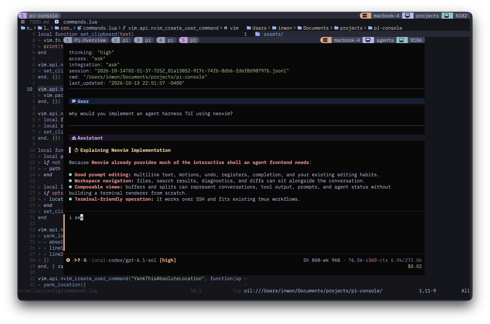

# pi-console

A Neovim frontend for the [Pi coding agent](https://pi.dev), with tmux popups
and an overview for keeping track of multiple conversations.

Your existing Pi credentials, instructions, skills, settings, and packages carry
over. The extensions needed by the UI are bundled.

This is a work in progress that I use daily and share as inspiration for similar
setups. Future maintenance and support are not guaranteed.



## Features

- Editable Markdown prompts and rendered transcripts in ordinary Neovim buffers.
- Searchable session history, transcript previews, and conversation branching.
- Multiple conversations with a tmux popup, overview, and compact sidebar.
- Tool output, reasoning traces, and subagent transcripts you can open on demand.
- Access modes, approval dialogs, isolated Git workspaces, and diff review.
- Model and thinking-level selection, queued prompts, and usage/cost information.


## Requirements

Developed against **Neovim 0.12, Pi 1.3.0, and tmux 3.7**. The tmux integration
supports **3.4 and newer**; older versions are best-effort. You also need:

- Git, Bash, curl, Node.js 20.11+, npm, `realpath`, `ripgrep`, and `fzf`;
- Rust/Cargo for `blink.cmp`, plus a C compiler and Tree-sitter parser toolchain;
- on Linux, `bubblewrap` and `socat` for command sandboxing;
- network access for initial package, plugin, and parser installation.

A Nerd Font and true-color terminal are recommended. Desktop notifications use
`alerter` and are currently macOS-only. For optional Zotero completion and LaTeX
graphics, see the [user guide](docs/USAGE.md).

## Install

Install the latest published release:

```sh
curl -fsSL https://raw.githubusercontent.com/inwonakng/pi-console/main/scripts/install.sh | bash
```

Add `~/.local/bin` to your `PATH` if it is not already there. The installer adds
`pi-console` (Neovim frontend) and `pi-stable` (Pi terminal UI), both using the
same installed release. Neither changes your regular Neovim configuration or
globally registers the bundled Pi package.

Run the same command again to update. To select a specific release:

```sh
curl -fsSL https://raw.githubusercontent.com/inwonakng/pi-console/main/scripts/install.sh | bash -s -- --version v2026.10.05.1
```

Restart existing frontends after updating; open windows keep their original
version. Check the running build with `:PiConsoleVersion` or
`pi-console --version`. Installation needs network access, so install a working
release before you need an offline fallback.

## Start a conversation

Run from your project directory:

```sh
pi-console
```

Write your prompt in the input buffer and press `<C-CR>` to send it. The prompt
and transcript are Neovim buffers: search, select, and navigate as you would
when editing code. `<leader>` is Space.

| Key | Action |
|---|---|
| `<leader>?` | Context-sensitive help and the full key list |
| `<leader>s` | Pick a session |
| `<leader>T` | Open the conversation tree |
| `<leader>m` / `<leader>t` | Choose model / thinking level |
| `<leader>pq` | View or edit queued prompts |
| `<leader>pa` | Reopen a pending question or approval |
| `<leader>pR` | Restart Neovim and Pi, preserving the conversation and unsent prompt |

Restart is refused while work or requests are pending; save or discard modified
file buffers first. `:PiRestart` restarts only Pi.

### tmux shortcuts

Set up bindings once inside your usual tmux setup:

```sh
pi-console tmux setup
```

This backs up changed configuration, saves the bindings, and applies them to the
running default server. If none is running, they take effect next startup.
Rerun after updates to pick up binding changes. When first enabling focus
reporting, detach and reattach existing tmux clients.

| Binding | Action |
|---|---|
| `<prefix>g` | Toggle the conversation popup |
| `<prefix>G` | Start a conversation in the current pane's directory |
| `<prefix>o` | Open or focus the overview |
| `<prefix>O` | Toggle the compact sidebar |

In the overview or sidebar, use `j`/`k` and Enter to select a conversation.
Use `g` to organize sessions into groups, `J`/`K` to reorder, and Tab to expand
groups or running subagents. Pin saved conversations with `p` to keep them
available within their groups after closing their windows. See the
[user guide](docs/USAGE.md#session-overview) for list controls and
[tmux integration](docs/USAGE.md#tmux-integration) for layout details.

## Configuration and permissions

Copy the [example configuration](pi/pi-console-config.example.yaml) to
`~/.pi/agent/pi-console-config.yaml` to override notification, access-mode, and
integration defaults. Existing session choices take precedence over defaults.

**Reads are unrestricted by default, including credentials and private files.**
The default `ask` mode requests approval for additional writes and shell network
access; `edit` also permits workspace writes, while `full` removes filesystem
and network restrictions. `readonly` permits configured reads and scratch writes.
User-entered `!`/`!!` shell commands bypass the agent's sandbox.

Project trust is separate from tool permissions: it controls loading project
configuration and executable resources. New undecided projects wait for your
trust choice before agent work starts.

The bundled subagent and workspace tools are inactive by default. To enable
them, merge this into `~/.pi/agent/settings.json` and restart:

```json
{
  "defaultTools": ["+spawn", "+spawn_control", "+workspace"]
}
```

General-purpose question, todo, web-search, and LiteLLM extensions are not bundled;
install them separately through Pi. See the [user guide](docs/USAGE.md) for the
full configuration, permission behavior, and optional features.

Credentials, settings, and history are shared with your other Pi installations.
Do not edit the same conversation in two processes. Selecting an older release
does not roll back shared user data.

## More information

- [User guide](docs/USAGE.md): screenshots, dialogs, tmux details, configuration,
  access modes, Zotero references, and LaTeX graphics.
- [Maintaining pi-console](MAINTAINING.md): development setup, release publishing,
  installation layout, and migration/recovery procedures.

## License

[MIT](LICENSE)
