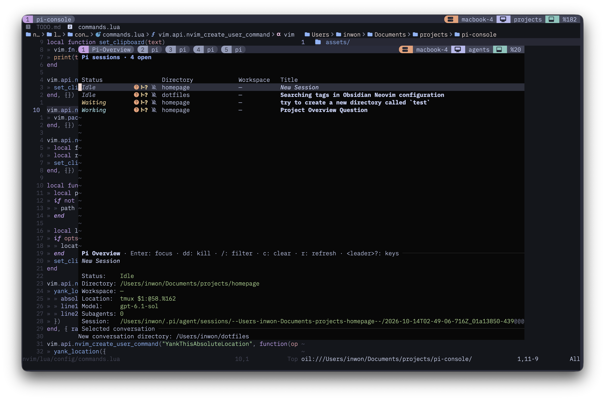
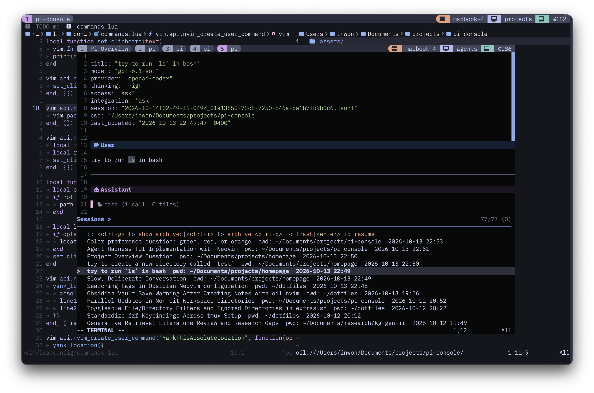
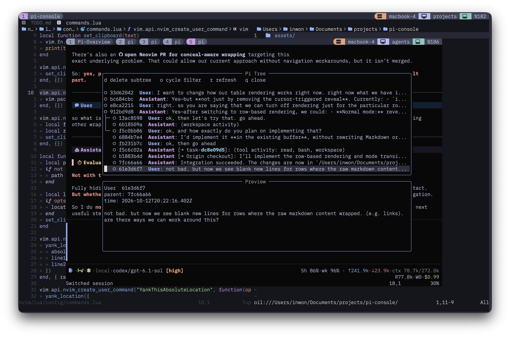
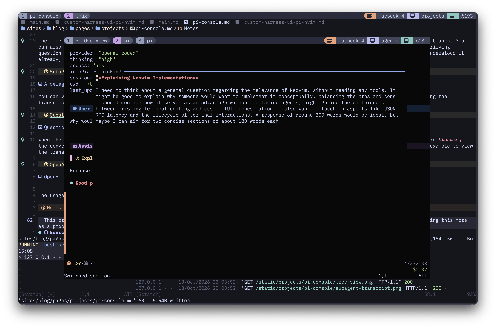
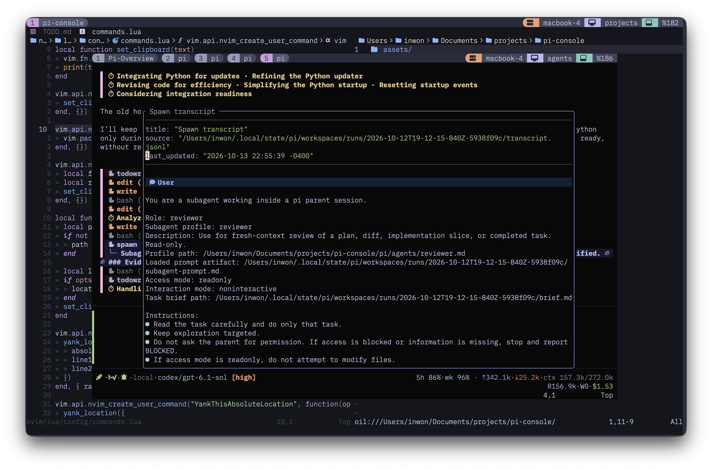
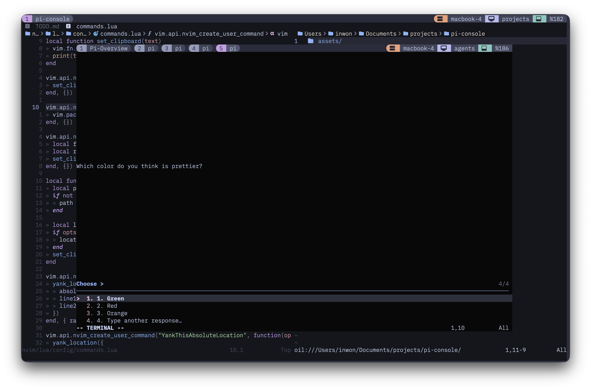
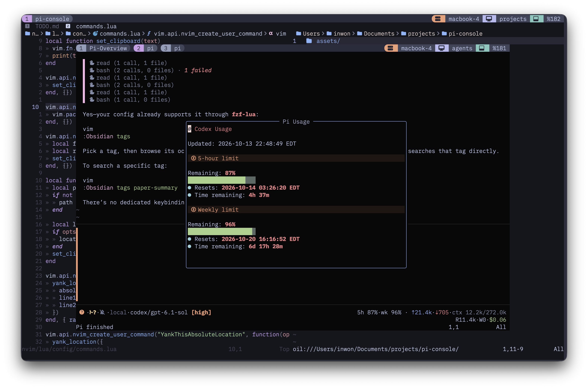

# User guide

See the [README](../README.md) for installation and a quick start, or
[MAINTAINING.md](../MAINTAINING.md) for development and releases.

- [Optional dependencies](#optional-dependencies)
- [Conversation controls](#conversation-controls)
- [Sessions and dialogs](#sessions-and-dialogs)
- [tmux integration](#tmux-integration)
- [Zotero references](#zotero-references)
- [LaTeX graphics](#optional-latex-graphics-in-tmux)
- [Configuration](#configuration)
- [Bundled extensions and optional tools](#bundled-pi-extensions)
- [Access modes](#access-modes)
- [Project trust](#project-trust)

## Optional dependencies

In addition to the [core requirements](../README.md#requirements):

- Use a Nerd Font and true-color terminal for the intended interface.
- Install `alerter` for desktop notifications (currently macOS-only).
- Install `diffview.nvim` in the regular Neovim configuration used for workspace
  diff review.
- Install `fd` or `fdfind` for faster file completion.
- Install `trash` or `gio trash` to send deleted sessions to the OS trash;
  without them, deletion is permanent.
- Zotero completion and LaTeX graphics need the setup described in their
  respective sections below.

## Conversation controls

The prompt is an editable Markdown buffer; the transcript is a searchable
Neovim buffer. Press `<leader>?` for context-sensitive help.

- Press `<CR>` on a tool group to expand it, or on an individual call to open
  its output. Consecutive calls to the same tool group together, expand while
  running, and collapse when finished. Manually toggled groups keep your choice;
  collapsed summaries still label running and failed calls.
- Queue prompts while an agent is working. `<leader>pq` previews, edits, or
  deletes queued messages. They run in order after the current run, waiting
  while the next message is being edited.
- Open a workspace integration result and press `d` to inspect its historical
  diff in Diffview. Snapshots remain available after workspace cleanup and
  later checkout edits. Each result describes its own attempt, including
  partially applied failures. Ignored files are listed separately from the Git
  diff; binary files have no line totals.
- In a task worktree, the orange statusline summary shows added/removed lines
  and changed files since task creation, including new non-ignored files.
  Binary files count as changed files without line totals.

## Sessions and dialogs

### Session overview

This is where I go when I've lost track of which conversation is doing what.
It lists open sessions, whether they're working, idle, done, or waiting for me,
and their directories and workspaces. `Done` means a turn finished normally while
I was elsewhere; focusing that conversation clears it to `Idle`. `Waiting` means
an outstanding question or approval still needs a response. Reopened sessions
start idle; unread status is not saved. The overview and sidebar share named
groups and manual ordering. Pins (``) stay within their groups: press `p` on a
saved session to keep it visible after its window closes and across restarts,
with status `Not Open`. Enter focuses an open session or reopens a closed pin.
Unpinning a closed session hides it, without removing its history or group assignment.

Both lists use the same controls:

| Binding | Action |
|---|---|
| `j` / `k`, arrows | Select a group or session; skip display-only rows |
| `Tab` | Expand/collapse a group or a session's running subagents |
| `Enter` | Focus/reopen a session, or expand/collapse a group |
| `J` / `K` | Move a session within its group, or reorder a selected group |
| `g` | Assign a session to an existing/new group; on a header, create an empty group |
| `p` | Toggle a session's pin |
| `dd` | Kill/close a session, or delete a group without killing its sessions |
| `<leader>?` | Show the list's keys |

Deleting a nonempty group asks for confirmation and appends all its sessions,
including remembered closed sessions, to Ungrouped in their existing order.
Pins are preserved. Ungrouped cannot be deleted or reordered and stays last;
it hides when empty. Explicit groups remain even when empty. Closing an unpinned
session hides its row but preserves its group and position for reopening.

Collapsed groups show session-status icon counts. Collapsed sessions show their
running-subagent count; expanded sessions show one display-only row per running
subagent. Collapse state is independent in each viewer. These are highlight-only
lists, with the normal cursor restored in inputs and dialogs. Ordinary Neovim
scrolling is unchanged; there are no Shift-Enter or Ctrl-x list bindings.
The overview also provides `/` to filter and `c` to clear the filter. Filtering
hides groups without matching sessions but never deletes them. I keep the overview
bound to `<prefix>o` so I don't have to remember where each conversation lives.



<details>
<summary>Session picker and transcript preview</summary>

When I want to pick up an older conversation, I search for it here and check
the transcript preview before opening it. Like the other pickers, this uses
[fzf-lua](https://github.com/ibhagwan/fzf-lua). You can also select several
sessions at once to archive or delete them.



</details>

<details>
<summary>Conversation tree</summary>

The tree lets you revisit earlier messages, take a different branch, or remove
messages you no longer need. I find this useful for asking clarifying questions:
once I understand the answer, I can go back to the original message and ask the
agent to start working, without keeping that whole detour in context.



</details>

<details>
<summary>Tool output and reasoning trace</summary>

Tool output, reasoning traces, and skill invocations open in floating buffers
when you want a closer look. This screenshot shows the agent's reasoning trace.
Press `q` to close it, or use `<C-h/j/k/l>` to return to the conversation.

Codemode's internal tools stay within its parent call rather than appearing as
separate transcript entries. Its detail view shows JavaScript-highlighted source
and wrapped output, reading Pi's full saved output when available. If that
temporary file is unavailable, the view labels the truncated recorded fallback.



</details>

<details>
<summary>Subagent transcript</summary>

You can check what a subagent is doing without leaving the parent conversation.
The subagent menu lets you open its transcript or send actions to it; this
screenshot shows a reviewer's transcript.



</details>

<details>
<summary>Question picker</summary>

When the agent asks a multiple-choice question, you can pick an answer or type
your own. If you need to reread the conversation first, you can hide the picker
and come back to it later. The agent still waits for your answer, and other
pickers stay unavailable until you resolve the question. `<Esc>` hides a pending
choice/confirmation, `<leader>pa` reopens it, and `<C-q>` cancels its request.
Freehand input uses a Markdown float: `:wq` submits; closing without writing
(for example `:q!`) returns to the choices. This presentation also works for
standard dialogs from other extensions. The question tool itself is supplied by a
separately installed extension.



</details>

<details>
<summary>OpenAI Codex usage</summary>

A quick way to check how much Codex quota is left before starting another task.
It shows the remaining five-hour and weekly quotas, when they reset, and how
long until then.



</details>

## tmux integration

Set up the installed release's tmux bindings:

```sh
pi-console tmux setup
```

Setup saves your choice in the main tmux configuration and immediately applies
the bindings to the current/default running server. If none is running, it saves
the choice for next startup without starting a server. No manual config edit or
reload is needed. Run the other channel's setup command to switch back; installing
or updating either application alone never changes this choice.

Setup backs up changed configuration and maintains one `pi-console` block at the
end of `~/.tmux.conf` (or the existing `$XDG_CONFIG_HOME/tmux/tmux.conf`). Dotfile
symlinks are preserved. Old installer blocks are replaced; unrelated settings and
included files are left alone. The final block overrides older bindings loaded
by includes. Custom configurations started with `tmux -f` must source this main
configuration to load the saved choice. Startup only applies bindings; it does
not rerun configuration editing.

The keys stay the same. Dev uses `agents-dev`; each installed commit uses
`agents-<commit-prefix>`, preventing recovery from attaching to a different
build's broken overview. Viewers can still list both channels. Stable setup
follows the installed `current` selection after installing another release.

Setup also enables modified-key settings and focus reporting, but not graphics
passthrough or graphics-depth hooks. When first enabling focus reporting, detach
and reattach existing clients. Then use:

| Binding | Action |
|---|---|
| `<prefix>g` | Toggle the selected channel's agents popup |
| `<prefix>G` | Start a conversation in the current pane's directory |
| `<prefix>o` | Open or focus the persistent overview; close the popup if already focused |
| `<prefix>O` | Toggle the compact overview sidebar in the current window |

Tmux 3.4 uses a popup; newer servers with modal-pane support use a modal pane.
Toggling closes only the nested client launched for that popup/modal, not a main
client viewing the same agents session. Pass the invoking client name when
calling `toggle` manually; without one, closing from the agents session is a no-op.

The sidebar shows open and pinned conversations with colored status icons,
conversation titles, projects, and current activity. Focus it with normal tmux
pane navigation, then use the [shared list controls](#session-overview) to organize
or focus sessions, `o` for the full overview, and `q` to close the sidebar. Its
collapsed-group summaries wrap beneath the heading to fit the narrow pane.
It is only a viewer and does not start an agent.

The sidebar is normally 34 columns wide, capped at one third of the window and
shrunk further if the content panes need the space. Opening it requires at
least 20 sidebar columns. Toggling inserts/removes only its marked pane and
resizes the current content layout proportionally; edits to that layout while
it is open are retained. Terminal resizing keeps the width while the sidebar
remains a full-height left pane. If you rearrange it into another layout, tmux
controls its size until you toggle it off and on. It does not follow you to
other windows or sessions. Native tmux zoom hides other panes as usual.

The `tmux` subcommands are `setup`, `toggle`, `new`, `overview`, and `sidebar`.
Only `setup` is normally needed manually; the keybindings use the other actions.
For example, `pi-console tmux sidebar "$TMUX_PANE"` toggles the installed release's sidebar.
After updates, rerun your chosen channel's `tmux setup` to apply changed bindings;
restart existing frontends to pick up UI changes.

Conversation windows created by the launcher use a fixed two-cell state icon
instead of the `pi` window name (requires a Nerd Font):

| State | Tab/sidebar icon | Color |
|---|---|---|
| Done / unread | `` | Green |
| Working / retrying | `` | Blue |
| Waiting for you | `` | Yellow |
| Compacting | `` | Mauve |
| Loading / starting | `` | Blue |
| Idle | `` | Muted |
| Error / stopped / unresponsive | `` | Red |
| Pinned, not open (sidebar only) | `` | Muted |

The bell follows the overview's unread state and clears when the conversation
is focused. Tab titles and sidebar icons share the same RGB colors. Only managed
conversation tabs receive title-color overrides; window indices, backgrounds,
and ordinary tabs retain their theme styling. Formats using direct `#W` or
`#{window_name}` title tokens are supported, including the default and
Catppuccin formats. Complex/indirect title expressions are left unchanged rather
than rewritten. Manually renaming a window opts it out of icon naming and
coloring; review splits do not take over its icon. On normal frontend exit, an
icon-named window returns to `pi` and its original title formats are restored.

On tmux 3.8 and newer, supported title formats use native status-line animation;
the underlying window name stays stable while the working/loading state is
unchanged. Older servers, or themes that cannot host the animation, retain
asynchronous frame-based window-name updates. The running server determines
support, not the version of the client binary in `PATH`.

You can also run `pi-console` directly from a project directory. Inside
pi-console, `<leader>?` shows the complete context-sensitive key list.
In directory prompts, `<C-f>` opens up to 10 unique recently used Pi working
directories, oldest to newest, while retaining your current input for editing.
Directory history persists across launches and accumulates as Pi sessions open
or change working directory.

Use `:PiConsoleRestart` or `<leader>pR` to restart both Neovim and Pi in the
same terminal/pane, preserving the conversation, working directory, unsent
prompt, and access/integration modes. Restart is refused while Pi work or
requests are pending; save or discard modified file buffers first. This
requires starting through `pi-console`. `:PiRestart` / `<leader>pr` continues
to restart only Pi.

## Zotero references

In the prompt buffer, type `@z:paper:`, `@z:collection:`, or `@z:tag:` to search
your local personal library. `@z:` also completes those namespaces. Queries can
contain spaces; papers match titles, short titles, citation keys, authors, and
tags. Choose a suggestion with the regular completion keys. Other sources,
including file completion, stay out of Zotero queries.

Keep Zotero running and enable **Settings → Advanced → Allow other applications
on this computer to communicate with Zotero**. Completion reads metadata from
`127.0.0.1:23119`, caches it in memory, and refreshes on use after a minute. If
Zotero is unavailable, a warning appears and any cached suggestions remain;
failed requests retry after ten seconds. It does not read PDFs/notes or write
to your library, and does not include group libraries.

Paper and collection suggestions insert readable native Zotero links. Tag
suggestions insert local API tag links with the exact tag name (metadata, not a
PDF); Zotero has no native tag-selection URI. Agent operations are separate: install `zotero-cli`
and supply agent instructions for resolving these references (the console does
not bundle a Zotero skill). The ordinary Pi terminal UI needs its own autocomplete
extension; RPC does not forward Pi autocomplete providers to Neovim. Restart the
console after updating the frontend.

## Optional LaTeX graphics in tmux

Display equations use the Kitty graphics protocol through
[nvim-extras](https://github.com/inwonakng/nvim-extras). They require a compatible
terminal (such as Kitty or Ghostty), `pdflatex`, ImageMagick, and the TeX packages
listed in the [renderer documentation](https://github.com/inwonakng/nvim-extras/blob/main/lua/latex_renderer/README.md).
Inline equations use `utftex`.

Graphics passthrough is a host-wide tmux policy, so the default integration and
installer leave it to your main tmux configuration. For standalone installations
that do not already configure it, explicitly source
[`tmux/graphics.conf`](../tmux/graphics.conf) from your main tmux config:

```tmux
# Default managed installation; adjust for a custom install directory or checkout.
source-file "$HOME/.local/share/pi-console/current/tmux/graphics.conf"
```

This optional file enables `allow-passthrough` and focus events globally and
installs graphics-depth hooks at index 90. The hooks set the session option
`@graphics-nest-count` to 1 for ordinary terminal clients or 2 for nested tmux
clients (identified by their terminal name matching `default-terminal`). The
renderer reads that option on startup and focus changes so popup graphics pass
through both tmux layers. These settings affect all applications on that tmux
server, not just pi-console. Keep them in your own config **or** source the
optional file; do not install both copies of the hooks.

After upgrading from the previously automatic setup, choose one of those
locations for the graphics settings. Reload your main tmux config and reopen
the popup so the client hooks run. Existing hooks remain in a running server
until removed or the server exits; running only `pi-console tmux setup`
does not remove them. Without an explicit graphics setup, a fresh server will
no longer enable passthrough automatically.

## Configuration

Optional extension overrides may be copied from
[`pi/pi-console-config.example.yaml`](../pi/pi-console-config.example.yaml) to
`~/.pi/agent/pi-console-config.yaml`.

Defaults and access paths can be changed with:

```yaml
notifications:
  default: enabled
integration-mode:
  default: ask
access-mode:
  default: ask
  read-paths: ["/"]
  write-paths: ["/tmp"]
  # temp-dir-prefix: /tmp/pi-console-
```

Omitted defaults use the values shown. `notifications.default` accepts `enabled`
or `disabled`; `access-mode.default` accepts `readonly`, `ask`, `edit`, or `full`;
`integration-mode.default` accepts `ask` or `allowed`. Defaults apply on session
start and tree navigation when there is no saved choice on the active branch.
Saved session choices take precedence; spawned subagents also retain their
explicit access-mode override. Editing these defaults does not change an active
session immediately.

Omitted path lists use the defaults shown. Lists contain absolute or `~/` paths,
not wildcards, and include descendants. They add to workspace/system reads and
mode-specific writes. `read-paths: []` restricts reads to that baseline;
`write-paths: []` removes automatic `/tmp` writes. Writable paths are also
readable. Read/write changes apply to subsequent tool calls.

Each Pi process creates a unique scratch directory under the OS temp directory
(`os.tmpdir()`, normally under `/var/folders/…` on macOS). An optional full
`temp-dir-prefix` changes where it is generated on the next Pi session:
`/tmp/pi-console-` becomes `/tmp/pi-console-XXXXXX`. Missing parent directories
are created. The scratch directory becomes Bash's `$TMPDIR`, is automatically
writable by both Bash and file tools in every mode, and is removed on shutdown.
Only the generated directory is removed, not its configured parent.

pi-console uses the existing Pi agent directory, including credentials,
instructions, skills, prompts, models, and other packages.

## Bundled Pi extensions

Each frontend/terminal launcher explicitly loads its matching package for that
process, including its subagents. These extensions are available through
`pi-console`, `pi-console-dev`, `pi-stable`, and `pi-dev`, not automatically through
plain `pi`:

| Extension | Capability |
|---|---|
| `access-mode` | Sandboxed read-only, approval, edit, and unrestricted access modes |
| `auto-title` | Automatic and explicit session titles |
| `codex-usage` | OpenAI Codex usage status |
| `history` | Session history, archive, restore, and transcript operations |
| `notifications` | Completion and input-request notifications |
| `spawn` | Background and foreground subagents |
| `tree` | Session-tree navigation helpers |
| `workspace` | Isolated Git workspaces and integration |

General-purpose `question`, `todowrite`, `web_search`/`web_fetch`, and LiteLLM
extensions are not bundled. Install them separately through ordinary Pi extension
discovery. The console supports standard choice, confirmation, and input dialogs
from any extension, and optionally renders todo results from saved history. Console
installation does not install or require personal dotfiles extensions. When
upgrading an existing web extension setup, move `web-search.providers` from
`pi-console-config.yaml` to `webSearch.providers` in Pi `settings.json`, then remove
the old YAML section; the console no longer accepts that section.

### Optional tool selection

`spawn`, `spawn_control`, and `workspace` register inactive. To enable them by
default, add this to `~/.pi/agent/settings.json` (merge it with existing tool choices):

```json
{
  "defaultTools": ["+spawn", "+spawn_control", "+workspace"]
}
```

A trusted project's `.pi/settings.json` can subtract from that selection:

```json
{
  "defaultTools": ["-spawn", "-spawn_control", "-workspace"]
}
```

Their commands and lifecycle hooks remain loaded, including workspace state updates
needed by the frontend. Selection applies at startup; restart after removing tools
from settings because Pi's `/reload` does not deactivate previously selected tools.
Explicit CLI tool choices override settings. This is not a permission policy.

### Access modes

The access modes are:

- `readonly`: configured reads and scratch writes; other writes and shell network access denied;
- `ask`: configured reads, configured writes (default `/tmp`), and scratch writes;
  approval for additional writes, restricted reads, and shell network access;
- `edit`: the same as `ask`, plus automatic workspace writes; and
- `full`: unrestricted host-user filesystem and network access.

There is one permission rule: access allowed by the configuration, mode, or an
existing grant proceeds; additional access asks in interactive `ask`/`edit` and
is denied explicitly in `readonly`. Configured write paths and remembered grants
do not permit non-scratch writes in `readonly`.

**Reads are unrestricted by default, including credentials and private files.**
There is no special-directory or credential-name blacklist. The shell inherits
its normal environment without secret-name filtering.

Bash and file tools share read/write permissions, including the scratch directory.
File tools request additional access to their target automatically. For Bash,
declare only additional `writePaths` before execution. `readPaths` is needed
only when reads are configured to be restricted; request specific required paths,
not whole-filesystem access for incidental configuration lookups. A write grant
includes reads of that path. Directory grants cover descendants.
`workspaceWriteAccess: true` is shorthand for including the current directory in
`writePaths`. The existing `broadReadAccess: true` explicitly requests all reads
for one command when configured reads are restricted; it is unnecessary with the
default configuration and grants neither writes nor network access.
`networkAccess: true` requests outbound network access to any host **for that
command only**, before execution. This can send data the command can read,
including inherited environment values; it does not lift filesystem restrictions
or the runtime's network safeguards. Network access is routed through the sandbox
proxy; it never opens a permission prompt while a command is running. Undeclared
access is denied, with the destination reported when available.

On macOS, `unixSocketPaths` requests Unix-socket binding and connections at
literal socket paths or directories (directory approval includes descendants).
Inspect Bash's `$TMPDIR` to find Neovim's temporary socket directory, then pass
its literal path rather than `$TMPDIR` as a string. Socket approval does not grant
filesystem reads/writes, outbound-network access, or TCP binding. Access to Unix
sockets can expose powerful local services; approve only the needed paths. The
runtime cannot enforce path-scoped socket grants on Linux, so such requests are
rejected before execution rather than widened to all sockets.

Scoped filesystem approvals offer Allow once, Allow for session, or Deny.
Network access offers Allow once or Deny and is never saved. Existing saved
read/write and host-specific network grants are retained on resume, but not
inherited by new/forked sessions or subagents. A saved host grant does not grant
access to other hosts. Approval previews distinguish the **Access scope** being
requested from the **Command CWD** where the command starts.

Explicitly user-entered `!`/`!!` commands run through Pi's normal shell path with
host-user permissions, without this extension's sandbox or approval checks.
Agent-generated Bash commands remain access-controlled.

Bash has no default execution timeout. The agent is instructed to use `timeout`
for diagnostic probes expected to finish quickly or when the user requests an
execution deadline, and to omit it otherwise. Probe deadlines should match the
expected execution time, not impose arbitrary limits on builds, installs, or
other legitimately long-running work. Command-level timeouts such as
`curl --max-time`, `curl --connect-timeout`, or the `timeout` utility remain
reserved for explicit user requests or testing timeout behavior. All upfront
approvals finish before the shell and its execution timer start.

Agent-written diagnostic scripts must terminate after collecting results and
exit nonzero on initialization or execution failure. Headless Neovim probes
should catch initialization errors and exit with `cquit`; a Lua error alone does
not terminate the editor. Any watchdog must be installed before loading plugins
or other fallible initialization, so an earlier error cannot bypass it.

If granular permissions cannot support an operation (for example, raw networking
or a literal path containing sandbox wildcard characters), request
`unsandboxed: true`. This explicitly asks to run that command with unrestricted
host filesystem, environment, and network access, without changing the
session's mode. The same fallback is offered when the sandbox is unavailable or
cannot prepare a command before execution. The picker offers Allow once,
Allow this command outside the sandbox for this session, or Deny. Session approval
matches the **exact command text and canonical Command CWD**, not a prefix. It
includes future changes to scripts and execution of child processes with
unrestricted host access; it does not confine their effects to the script's
directory. Different arguments, appended shell commands, or a different CWD need
new approval. Keep script modifications in separate calls from the stable run
command to reuse approval. Remembered approval is only consulted when a command
needs unsandboxed execution; it never moves a normally sandboxed run outside the
sandbox.

Unsandboxed and Unix-socket session grants are held only in memory. They expire
on session/branch replacement or process exit, are not saved for resume, and are
not inherited by forks or subagents. Both are blocked in `readonly`. Approval is
never offered as an automatic rerun after partial execution.

Detected sandbox denials are reported with available diagnostics and partial
output, even when the command exits zero. Commands are never automatically
rerun after a sandbox block: inspect what already happened, then request the
needed access with an appropriate continuation command (`networkAccess: true`
for a proxy allowlist denial, `readPaths`/`writePaths` for filesystem denials,
`unixSocketPaths` for Unix-socket denials on macOS).
Network permission does not fix DNS, TLS, or server errors. Detection is best-effort;
suppressed errors may not be observable. `readonly` and noninteractive sessions
do not prompt for additional access.

The bundle registers `bash`, `spawn`, `spawn_control`, and `workspace`. Other
personal/trusted-project resources still load; avoid competing tool registrations.
Do not globally register another pi-console checkout or release: explicit loading
is additive, not a replacement for another copy. Remove additional manually
registered copies with `pi remove <exact-source>`. Installers migrate only the
registrations whose ownership they can establish.

The profiles under `pi/agents/` are defaults used by the bundled `spawn`
extension, not a standard Pi resource directory. Additional profiles can be
placed in `~/.pi/agent/agents/` or a trusted project's `.pi/agents/` directory.
A user profile overrides a bundled profile with the same name, and a project
profile overrides both.

Delegation primarily serves read-heavy work: research, investigation,
summarization, review, and verification. The bundled `researcher`, `reviewer`,
and `verifier` profiles default to read-only access. The main agent normally
implements changes; `worker` defaults to edit access in an isolated child worktree
for approved, self-contained tasks with settled requirements, non-overlapping
ownership, and independently verifiable results. Delegate writing only when its
benefit outweighs briefing and integration overhead; keep tightly coupled changes
and evolving design decisions in the main session.

## Project trust

The selected installation's bundled Pi extension owns trust checks and metadata. Neovim only
runs its startup handshake, displays standard RPC dialogs, and restarts Pi when
requested. An undecided project starts untrusted; agent work and automatic
workspace restoration wait for setup. Approval restarts Pi before loading project
resources. Already-decided projects do not need this extra restart.

When Pi's policy is `ask` and no decision applies, the picker offers trust,
parent-folder trust, conversation-only trust, or decline. `<C-q>` declines for this
conversation; `<Esc>` hides the picker and `<leader>pa` reopens it. `AGENTS.md`
alone does not require approval; Pi gates project configuration and executable
resources, not ordinary context files.

Permanent choices use Pi's native `trust.json`, including parent inheritance and
`PI_CODING_AGENT_DIR`. Conversation-only decisions live separately beneath
`<agent-dir>/pi-console/session-trust/`, keyed by canonical session filename and
project directory (an exact match, not blanket parent-folder approval). They
survive RPC and full-console restarts without modifying the conversation JSONL or
the global trust store. New conversations and unrelated projects do not inherit
them. Forking asks before copying a conversation-only decision to the fork.

Managed external workspaces inherit their originating project's decision through
validated workspace/session records, including nested child workspaces. Unknown
or unrelated worktrees get their own decision. Workspace/history transitions
check the destination before switching; the session picker and new-session action
restart RPC to avoid reusing another conversation's cached trust. Finish or abort
active work before changing conversations.

The launchers explicitly load their matching pi-console package (verified against
Pi 1.3.0). Personal trust handlers that run before ours retain Pi's precedence. There are no
`--approve` overrides or separate Neovim-side JavaScript helpers. Trust setup
errors keep agent work blocked rather than implicitly approving resources.
Project trust controls resource loading, not tool permissions or filesystem access.
